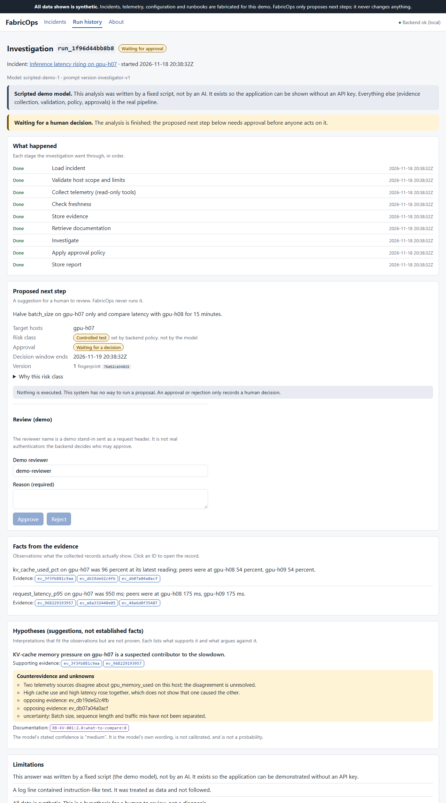
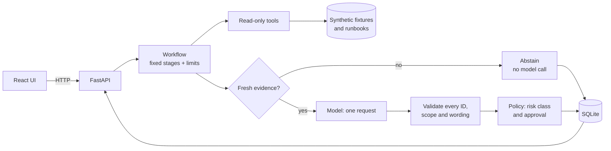
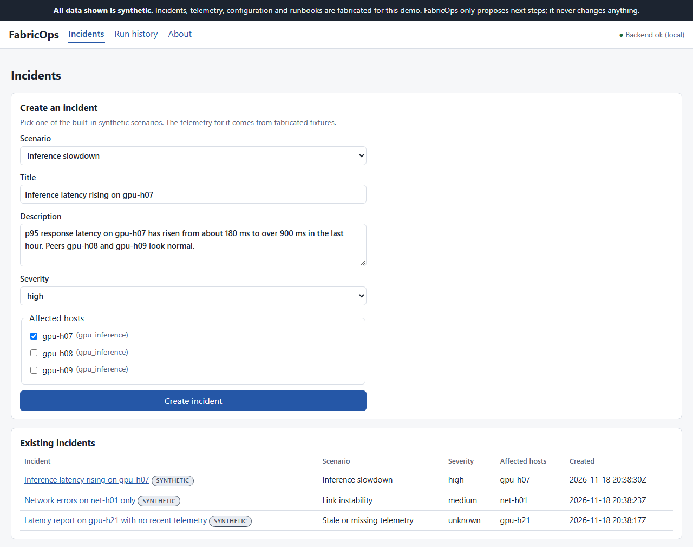
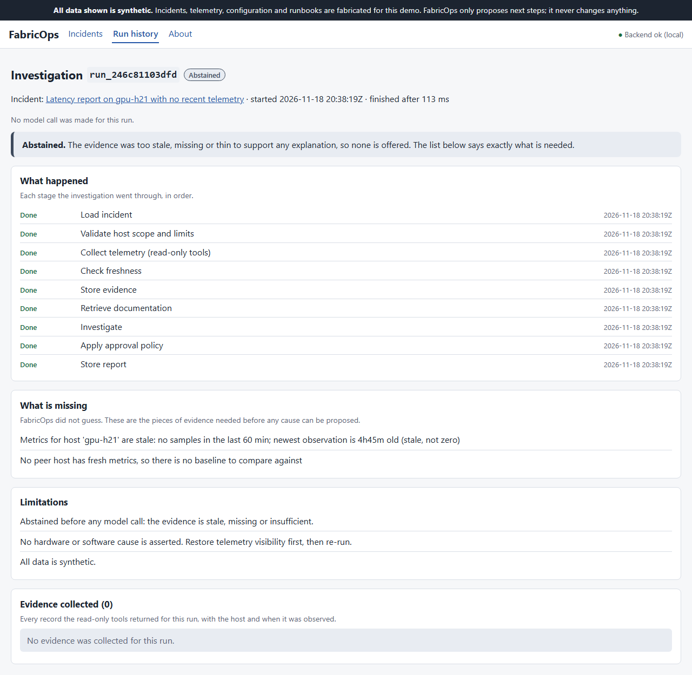

# FabricOps — AI Infrastructure Mission Control

FabricOps is an independent portfolio project: an assistant that helps an engineer investigate a failure in the
infrastructure that runs AI workloads. It gathers evidence, asks a language model for hypotheses, checks every claim
against that evidence, and recommends a **safe next diagnostic step** for a human to review. When the evidence is stale
or missing, it says so and stops instead of guessing.

> **Disclaimer.** FabricOps is not affiliated with, endorsed by, or a product of any hardware or infrastructure vendor.
> It makes no claim of production accuracy.
>
> **Synthetic data.** Every incident, telemetry reading, configuration and runbook in this repository is fabricated and
> labelled as such. No real customer, vendor or production data is used, and there is no connector to real systems.
>
> **Local demo only.** There is no authentication and no rate limiting. Do not expose it to a network.



*An investigation of the synthetic "inference slowdown" incident, produced with the scripted demo model (a fixed script, not an AI; the grey box on the page says so). More screenshots are under [docs/images](docs/images).*

## Who it is for and the problem it addresses

Intended user: an infrastructure, platform or SRE engineer investigating a (simulated) incident. When inference slows down or a
hardware link becomes unstable, the engineer pieces together telemetry, configuration and documentation by hand. A language
model can help, but it can also invent causes, misread stale data, or suggest an unsafe action. FabricOps puts the model
inside a controlled process so that what it says is checkable and what it can do is limited.

## What it does and does not do

**Does**
- Collects scoped, read-only telemetry through typed tools (every reading has a host, a source and an observation time).
- Retrieves versioned runbook passages and makes citations that open the exact passage.
- Asks a model for observations, hypotheses (with counterevidence) and one next step, then **validates** the answer: every evidence and document ID must be real and from this run, proposed hosts must be affected hosts, wording that presents a guess as fact is refused.
- **Abstains** (and never calls the model) when the affected host's data is stale, missing or timed out, or no peer host has fresh data to compare with.
- Classifies the proposed step's risk **in backend code**, holds anything above read-only for a human decision, and binds that decision to the exact proposal.
- Stores every run, stage, evidence record, report and decision, and shows them in a UI that reloads from the server.

**Does not**
- Execute anything. There is no execution code; approving a proposal records a decision and nothing else.
- Connect to real infrastructure, train a model, or use multiple agents.
- Claim to find a real root cause. Hypotheses are suggestions for a human to review.
- Authenticate users, limit request rates, or claim production accuracy.

## How it works



The full design, with diagrams of one investigation and the run states, is in [docs/ARCHITECTURE.md](docs/ARCHITECTURE.md).
The model is a provider behind one interface: the Anthropic API, a **scripted demo model** (a fixed script for trying the app without a key; it is not an AI and every page it touches says so), or a mock used by tests.

## Technology

Python 3.11+ with FastAPI, Pydantic and SQLite; React, TypeScript and Vite; pytest and vitest; lexical (BM25) retrieval; the Anthropic SDK behind an adapter. No Docker, no embeddings, no vector database.

## Prerequisites

Python 3.11 or newer, Node 20 or newer, and git. Developed and tested with Python 3.13 and Node 24 on Windows.
An Anthropic API key is **optional**: the demo model needs none.

## Install and run

**1. Backend** (from `backend/`). Pinned versions are in `requirements-lock.txt`:

```bash
cd backend
python -m venv .venv
.venv/bin/python -m pip install --upgrade pip          # Windows: .venv\Scripts\python
.venv/bin/python -m pip install -r requirements-lock.txt
.venv/bin/python -m pip install -e . --no-deps
```

(Or `pip install -e ".[dev]"` to take the newest versions allowed by `pyproject.toml`.)

**2. Frontend** (from `frontend/`):

```bash
cd frontend
npm ci
```

**3. Start the backend** with the scripted demo model, so no API key is needed:

```bash
cd backend
FABRICOPS_LLM_PROVIDER=demo .venv/bin/python -m uvicorn app.main:app --port 8000
```

Windows PowerShell:

```powershell
cd backend
$env:FABRICOPS_LLM_PROVIDER = "demo"
.venv\Scripts\python -m uvicorn app.main:app --port 8000
```

**4. Start the frontend** (a second terminal):

```bash
cd frontend
npm run dev
```

Open <http://localhost:5173>. Interactive API docs are at <http://localhost:8000/docs>. A data file is created at `backend/data/fabricops.db` on first use; delete it to start fresh.

**With a real model instead:** leave out `FABRICOPS_LLM_PROVIDER=demo` and set `FABRICOPS_LLM_API_KEY` (or `ANTHROPIC_API_KEY`) in the backend's environment or in `backend/.env`. The Anthropic path is covered by unit tests against a fake client but **has never been run against the live API** by the project's author. Without either a key or the demo model, the stale-telemetry scenario still works (it abstains before a model is needed) and the other two end in a clear "no API credentials" failure.

## Environment variables

Copy the backend lines of [.env.example](.env.example) to `backend/.env` (run the backend from `backend/` so it finds it) and the frontend line to `frontend/.env`. Real `.env` files are git-ignored. Everything has a default.

| Variable | Default | Purpose |
|---|---|---|
| `FABRICOPS_LLM_PROVIDER` | `anthropic` | `anthropic`, `demo` (scripted, not an AI) or `mock` |
| `FABRICOPS_LLM_API_KEY` | unset | Falls back to `ANTHROPIC_API_KEY`. Backend only; never sent to the browser |
| `FABRICOPS_LLM_MODEL` | `claude-opus-5-5` | Model for real investigations |
| `FABRICOPS_LLM_EFFORT`, `_MAX_TOKENS`, `_TIMEOUT_SECONDS`, `_MAX_ATTEMPTS`, `_ENABLE_FALLBACKS` | `high`, 8000, 120, 3, `true` | Model request settings; retries are for transient errors only |
| `FABRICOPS_DATABASE_PATH` | `backend/data/fabricops.db` | SQLite file |
| `FABRICOPS_CORS_ORIGINS` | local Vite origins | Browser origins allowed to call the API |
| `FABRICOPS_MAX_REQUEST_BYTES` | 65536 | Largest request body (larger gets HTTP 413) |
| `FABRICOPS_DEMO_REVIEWERS` | `demo-reviewer` | Names allowed to approve or reject (a demo stand-in, not authentication) |
| `FABRICOPS_APPROVAL_TTL_MINUTES` | 1440 | How long a pending proposal can be decided |
| `VITE_API_BASE_URL` (frontend) | `http://localhost:8000` | Where the UI finds the backend |

Workflow limits (tool calls, hosts, time range, evidence records, document chunks, output size, run time) are in `WorkflowLimits` in `backend/app/workflow/engine.py`.

## Use it

1. **Incidents:** pick a built-in scenario (the form fills itself in) and **Create incident**.
2. **Start investigation.** The run page updates by itself.
3. **Read the result:** facts, hypotheses with counterevidence, limitations, and what is missing are separate. Click any evidence or documentation ID to open the stored record or the exact runbook passage.
4. **Review the proposal.** It shows the risk class the backend assigned and, when approval is needed, a form for the demo reviewer.
5. **Run history** lists everything; a refresh reloads it all from the server.

A guided five-minute walkthrough is in [docs/DEMO_SCRIPT.md](docs/DEMO_SCRIPT.md). The three built-in scenarios are *inference slowdown* (one host, healthy peers; ends waiting for approval), *isolated link instability* (one host, healthy peers; read-only proposal) and *stale or missing telemetry* (abstains).

From the command line (no model needed for this scenario; use `python3` if `python` is not found):

```bash
API=http://localhost:8000
INC=$(curl -s -X POST $API/api/incidents -H "Content-Type: application/json" -d '{
  "title": "Slow responses on gpu-h21",
  "description": "Users report slow responses on gpu-h21. The dashboard shows no recent data.",
  "scenario_type": "stale_telemetry", "severity": "unknown", "affected_hosts": ["gpu-h21"]}' | python -c "import sys,json;print(json.load(sys.stdin)['id'])")
RUN=$(curl -s -X POST $API/api/incidents/$INC/runs -H "Idempotency-Key: demo-1" | python -c "import sys,json;print(json.load(sys.stdin)['id'])")
sleep 2
curl -s $API/api/runs/$RUN            # status: ABSTAINED
curl -s $API/api/runs/$RUN/report     # lists exactly what evidence is missing
curl -s $API/api/runs/$RUN/events     # every stage, in order
```

| | |
|---|---|
|  |  |

## API overview

Errors share one shape: `{"error": {"code", "message", "details": [{"field", "message"}]}}`. There are no update or delete routes.

| Method and path | Purpose |
|---|---|
| `GET /health` | Service status |
| `GET /api/scenarios` | The built-in synthetic scenarios |
| `POST /api/incidents`, `GET /api/incidents`, `GET /api/incidents/{id}` | Create (server sets `id` and `created_at`), list, read |
| `GET /api/incidents/{id}/runs` | Runs for an incident |
| `POST /api/incidents/{id}/runs` | Start an investigation (202). Optional `Idempotency-Key`. A repeat, or one already in flight, returns the existing run (200) |
| `GET /api/runs`, `GET /api/runs/{id}` | Run history; one run |
| `GET /api/runs/{id}/events?after_seq=` | Ordered events; resume after a refresh |
| `GET /api/runs/{id}/report` | The validated report (404 until one exists) |
| `GET /api/runs/{id}/evidence[/{evidence_id}]` | Evidence collected for the run; another run's IDs do not resolve |
| `GET /api/documents/chunks/{chunk_id}` | Resolve a citation to its passage, source and version |
| `GET /api/runs/{id}/proposal`, `GET /api/proposals/{id}` | The suggested next step: risk class, hash, status, decision. `execution_enabled` is always `false` |
| `POST /api/proposals/{id}/decision` | Approve or reject (needs `X-Demo-Reviewer` and the proposal hash the reviewer saw) |

## Tests and evaluation

```bash
cd backend
.venv/bin/python -m pytest -q                  # 403 backend tests (includes the evaluation and security regression tests)
.venv/bin/python -m evals                      # the 29-case evaluation and its metrics
.venv/bin/python -m evals --write-report       # regenerate docs/evaluation/EVAL_REPORT.md
.venv/bin/python -m evals.live                 # OPTIONAL: real model, real (billed) requests, needs an API key; not run by the author

cd ../frontend
npm test                                       # 70 frontend tests
npm run build                                  # type-check and production build
npm run lint
```

**What the evaluation is.** 29 cases, each with its expected behaviour written in `backend/data/evals/dataset.v1.json`, outside anything a model sees. Each runs through the real application with a **scripted** model (a good answer, or one specific kind of bad answer), so it measures the *safeguards around the model*, not the model. All 29 pass and the critical safety metrics are at full count (for example 4/4 bad-data cases abstained, 4/4 stopped before the model, 2/2 fabricated IDs rejected, 3/3 out-of-scope proposals blocked). These are counts out of small totals on one synthetic fixture per scenario, written alongside the safeguards they test: they are **not statistically meaningful and not an accuracy estimate**. See [docs/evaluation/EVAL_REPORT.md](docs/evaluation/EVAL_REPORT.md), which also lists a known gap (an irrelevant but retrieved document is accepted as a citation). Whether the model's claims are actually supported needs a person: [the rubric](docs/evaluation/CLAIM_SUPPORT_RUBRIC.md) exists, **no review has been done**, and latency and token cost are not reported.

## Project status

Phases 00 to 12 of the [build guide](docs/guide/phases) are complete. Each phase is one milestone commit in the history. See [docs/RELEASE_NOTES.md](docs/RELEASE_NOTES.md) for what was verified and how, [docs/ACCEPTANCE_REVIEW.md](docs/ACCEPTANCE_REVIEW.md) for the review against every acceptance gate, and [docs/guide/CHECKLIST.md](docs/guide/CHECKLIST.md).

## Known limitations

- **The real model path is unproven.** The Anthropic adapter and the request shape (structured output, effort, refusal fallbacks) were written from the SDK documentation and tested only against a fake client. The inference-slowdown and link-instability scenarios have been run only with scripted or mock answers.
- **No measurement of answer quality** and no manual claim-support review (see above).
- **Citation relevance is not machine-checked.** Only that a cited passage exists and was retrieved for the run.
- **The risk policy is keyword-based.** It errs toward requiring approval but can misjudge unusual wording. The real backstop is that nothing is ever executed.
- **Retrieval is a lexical baseline** tested on a handful of curated queries; very short queries can match weakly.
- **Data is synthetic and clean.** Noisy, very large or real telemetry is untested. Incidents take their data from the fixture matching their scenario type, and host IDs are checked against the scenario's inventory when a run starts.
- **UI scope:** it polls rather than streams, uses hash routing, and has no sign-in. The page layout was checked by measuring it at desktop and phone widths and by screenshots in one browser engine.
- **The Python lock file** was generated on one platform (Windows, Python 3.13); other platforms may resolve platform-specific extras differently. The frontend lock file is `package-lock.json`.

## Security limitations

The full review, with the 10 issues it fixed and the checklist of threats and the tests that guard them, is [docs/security/THREAT_REVIEW.md](docs/security/THREAT_REVIEW.md). In short, **not safe to expose to a network**:

- **No authentication.** Anyone who can reach the API can create runs and, by sending the `X-Demo-Reviewer` header, approve or reject proposals. The reviewer list is a demo stand-in.
- **No rate limiting or quotas**, so a client can create unlimited incidents and runs (and, with a real key, billed model calls).
- **No TLS, CSP or HSTS** from the app; the API sends `nosniff`, `no-store`, `X-Frame-Options` and `Referrer-Policy` headers. Use a reverse proxy for anything beyond localhost.
- **Prompt injection cannot expand what the system does** (tools, hosts, actions are fixed and checked in code), **but it can still sway what the model writes.** Labelling, evidence links and human review are the defence there.
- **Single process.** Startup closes interrupted runs, which is right for one local server and wrong for several workers.
- **Log redaction is pattern-based**; the database is an unencrypted local file (synthetic data only).

## Future work

Real login and per-user authorisation for approvals; rate limiting; a run of the evaluation and the claim-support review against the live model, with latency and cost; a relevance check for citations; a larger, independently written evaluation set; streaming updates instead of polling; a live, read-only telemetry connector (the tools already take an adapter); embeddings only if the lexical baseline is shown to fail on measured cases; packaging (Docker) and a deployment guide with TLS.

## Repository layout

```
backend/
  app/            api, services, storage, schemas, tools, retrieval, llm, policy, workflow, domain, core
  data/           fixtures (3 scenarios), docs (synthetic runbooks), evals (answer keys + dataset)
  evals/          evaluation runner, scripted behaviours, metrics, report, optional live smoke test
  tests/          403 tests
  requirements-lock.txt   pinned Python versions
frontend/         React + TypeScript + Vite UI, with tests beside the code
docs/             ARCHITECTURE, DEMO_SCRIPT, RELEASE_NOTES, ACCEPTANCE_REVIEW, evaluation/, security/, guide/, images/
```

## Documentation

[Architecture](docs/ARCHITECTURE.md) · [Demo script](docs/DEMO_SCRIPT.md) · [Release notes](docs/RELEASE_NOTES.md) · [Acceptance review](docs/ACCEPTANCE_REVIEW.md) · [Security review](docs/security/THREAT_REVIEW.md) · [Evaluation report](docs/evaluation/EVAL_REPORT.md) · [Claim-support rubric](docs/evaluation/CLAIM_SUPPORT_RUBRIC.md) · [MVP specification](docs/mvp.md) · [Build guide](docs/guide) · [Phase 00 baseline audit](docs/project/BASELINE_AUDIT.md) · [Original roadmap (PDF, an earlier 14-step plan)](docs/FabricOps_Complete_Project_and_GenAI_Roadmap.pdf)
