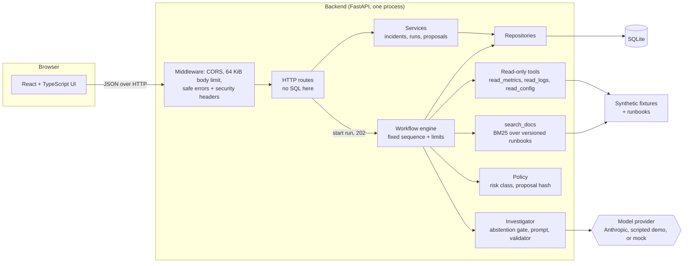
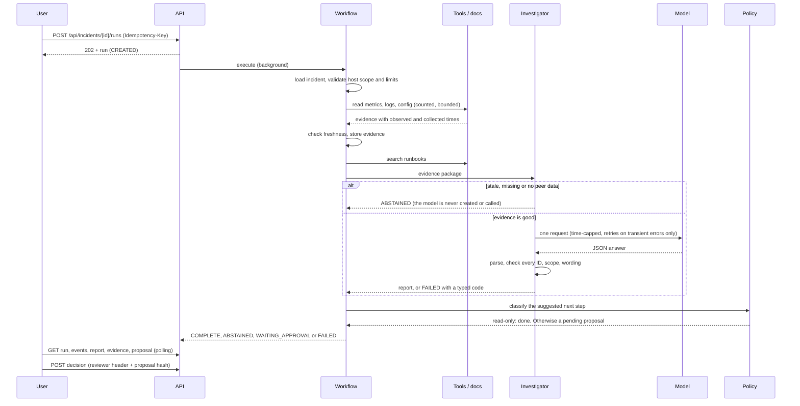
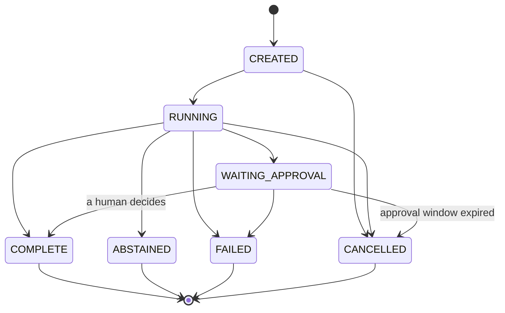

# FabricOps Architecture (as built)

This describes what the code does today. The build guide's original target design is in
[guide/02_ARCHITECTURE.md](guide/02_ARCHITECTURE.md); the differences are listed at the end.

All data is synthetic. FabricOps reads fabricated fixtures, never real infrastructure, and nothing in it can
execute a change on a host.

## System

The browser is never trusted with anything. It holds no keys; every action is validated again by the backend.

## One investigation

## Run states

Transitions are checked in code (`app/domain/run_state.py`) and applied with a compare-and-swap in the database, so two
writers cannot both move a run. At startup, runs that were `CREATED` or `RUNNING` when the previous server stopped are
closed as `FAILED` with code `interrupted`. Every change is also written to the `run_events` table, which is what the
UI's timeline replays.

## What lives where

| Area | Code | Responsibility |
|---|---|---|
| HTTP | `backend/app/api`, `app/core/security.py`, `app/core/errors.py` | Routes (no SQL), one error shape, body limit, headers, safe 500/503 |
| Domain models | `app/schemas` | Pydantic models with explicit units, UTC timestamps, `extra="forbid"` |
| Persistence | `app/storage` | SQLite schema (versioned), repositories, compare-and-swap, migrations |
| Services | `app/services` | Incidents, runs (idempotent start), proposals and decisions |
| Tools | `app/tools` | Exactly three read-only tools over a fixture adapter; typed, bounded, scoped |
| Retrieval | `app/retrieval`, `backend/data/docs` | Manifest, chunker with stable versioned IDs, BM25, `search_docs` |
| Model | `app/llm` | Provider interface; Anthropic adapter (the only file importing the SDK); scripted demo and mock providers; prompt; validator; investigator |
| Policy | `app/policy` | Deterministic risk class from wording, SHA-256 proposal hash |
| Workflow | `app/workflow` | The fixed stage sequence, limits, events, failure handling |
| UI | `frontend/src` | Typed API client, hash router, pages, evidence and citation inspector, approval panel |
| Evaluation | `backend/evals`, `backend/data/evals` | Dataset, runner, scripted model behaviours, metrics, report |

## Data model (SQLite)

`incidents`, `runs` (with an idempotency key), `run_events` (ordered), `evidence` (deterministic IDs per run, observed and
collected times kept apart), `investigation_reports` (validated report as JSON), `proposals` (versioned, hashed,
with expiry and the evidence they rest on), `approval_decisions` (actor, time, reason, hash; at most one per proposal
version). The schema is created on first use and migrated in place when it changes (currently version 3).

## The trust boundary

The backend, not the model, decides which tools exist, which hosts may be read, whether data is fresh, whether an ID is
real, what risk a proposal carries, and whether anyone may approve it. The model gets one evidence package and returns one
JSON answer; it has no tools, no loop, and no way to change any of the above. Log and document text reaches it only as
quoted, labelled data. There is no execution adapter anywhere: approving a proposal records a decision and nothing else.

## Differences from the original plan (`guide/02_ARCHITECTURE.md`)

| Plan | As built |
|---|---|
| Risk class and approval status as part of the report | Held on the proposal (`GET /api/runs/{id}/proposal`); the report holds the evidence-linked fields |
| `docs/project` and `docs/architecture` folders | `docs/` with `guide`, `evaluation`, `security`, `project`, `images` |
| Entities: Incident, Run, Evidence, Document chunk, Report, Proposal, Decision | Same, plus `run_events`; document chunks live in memory, loaded from the versioned corpus, not in SQLite |
| Run states | Same seven. `WAITING_APPROVAL` ends `COMPLETE` when a human decides and `CANCELLED` if the window expires |
| LLM provider adapter | Anthropic adapter, plus a scripted **demo** provider (not an AI) so the app and a fresh clone can be checked without a key, and a mock for tests |
| Incident data | Matched to a synthetic fixture by `scenario_type`; there is no live connector by design |
| Approver identity | A demo reviewer name in a request header; not authentication |
| Docker | Not provided. The project runs locally |

## Not in this design

Authentication, rate limiting, multi-process deployment, TLS, real telemetry connectors, embeddings or a vector database
(not needed by the retrieval baseline), and any form of remediation. See [security/THREAT_REVIEW.md](security/THREAT_REVIEW.md).
